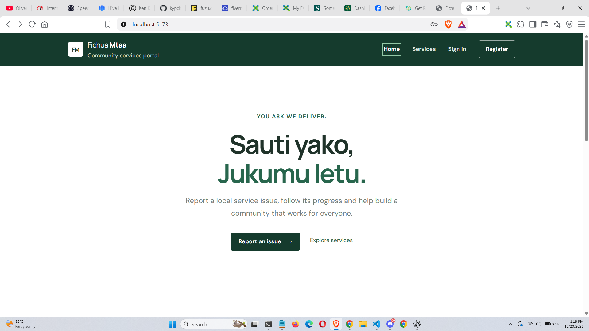
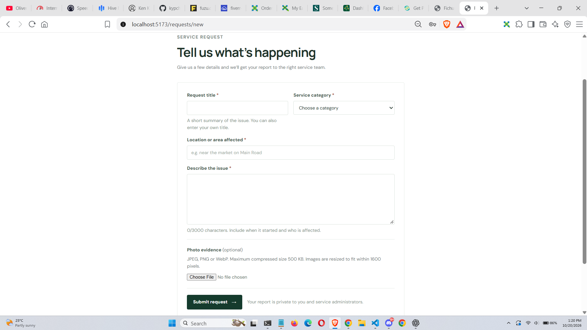
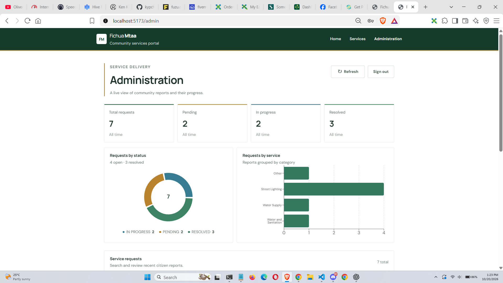
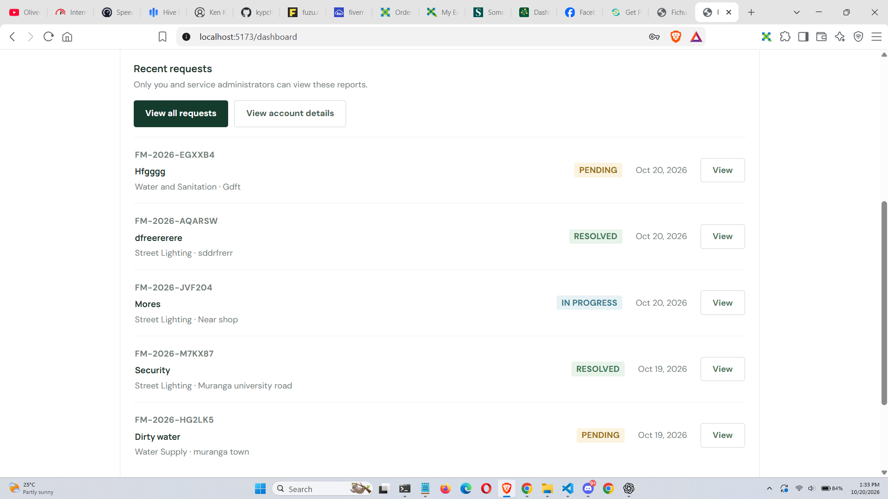

# Fichua Mtaa

Fichua Mtaa is an independent educational project inspired by Kenyan county service portals. It allows citizens to report local public-service issues and track progress while administrators manage reports and monitor service delivery.

*This is a portfolio demonstration, not an official government system.*

## Features

- **Citizen portal:** Register, sign in, submit reports and track request status and history.
- **Request management:** Unique reference numbers, categories, search, filters and optional photo evidence.
- **Admin dashboard:** Manage reports, update statuses, add private notes and view service-delivery analytics.
- **Attach 1 photo:** Take one clear photo of the affected area and attach it to your message for better evidence.
- **Account management:** Secure profile management and permanent account deletion with confirmation.
- **Security:** BCrypt password hashing, server-managed sessions, CSRF protection, role-based authorization and server-side validation.

> [!WARNING]
> **Password reset and account recovery are not available. Remember your password.**
Passwords are securely hashed in the database and cannot be retrieved as plain text. OTP-based password reset and account recovery are not currently implemented. Please remember your password when registering, as you will not be able to reset it through the application if you forget it.

Request statuses follow `PENDING → IN_PROGRESS → RESOLVED`.

## Technology Stack

| Area | Technologies |
|---|---|
| Frontend | React, Vite, JavaScript, React Router, plain CSS |
| Backend | Java 21, Spring Boot, Maven, Spring Security |
| Database | PostgreSQL, Spring Data JPA, Hibernate, Flyway |
| Charts | Recharts |
| Image storage | Cloudinary (optional) |
| Deployment | Render, Neon PostgreSQL |

## Project Structure

```text
Fichua-Mtaa/
├── frontend/       # React application
├── backend/        # Spring Boot REST API
├── README.md
└── render.yaml
 
```

The frontend communicates with the backend through REST APIs. The backend handles authentication, permissions, request processing, analytics and database operations.

## Prerequisites

- Java 21
- Maven 3.9+
- Node.js 20+ and npm
- PostgreSQL 15+

## Local Setup — Windows PowerShell

### 1. Create the database

Ensure PostgreSQL is running, then execute:

```powershell
psql -U postgres -h localhost -d postgres -c "CREATE DATABASE fichuamtaa;"
```

### 2. Configure the backend

```powershell
Copy-Item backend/.env.example backend/.env
notepad backend/.env
```

Configure your local database credentials and set `PORT=8081` if port 8080 is unavailable. Keep local credentials private.

Start the backend:

```powershell
cd backend
mvn spring-boot:run
```

Flyway applies the database migrations automatically.

### 3. Configure the frontend

In another PowerShell window:

```powershell
cd frontend
Copy-Item .env.example .env.local
npm install
npm run dev
```

Set `VITE_API_BASE_URL=http://localhost:8081/api` in `frontend/.env.local`.

Open the application at [http://localhost:5173](http://localhost:5173).

### 4. Create the first administrator

Set `ADMIN_EMAIL` and `ADMIN_PASSWORD` in the backend environment before its first startup. Use a unique password of at least 16 characters. Remove the bootstrap password after the administrator account is created.

Public registration creates citizen accounts only.

## Environment Variables

| Variable | Purpose |
|---|---|
| `VITE_API_BASE_URL` | Backend API URL |
| `DATABASE_URL` | PostgreSQL JDBC connection URL |
| `DATABASE_USERNAME` | Database username |
| `DATABASE_PASSWORD` | Database password |
| `FRONTEND_ORIGIN` | Allowed frontend origins |
| `SESSION_COOKIE_SECURE` | Secure cookie setting |
| `SESSION_SAME_SITE` | Session cookie cross-site policy |
| `ADMIN_EMAIL` | Initial administrator email |
| `ADMIN_PASSWORD` | Initial administrator password |
| `CLOUDINARY_CLOUD_NAME` | Optional image storage configuration |
| `CLOUDINARY_API_KEY` | Optional image storage credentials |
| `CLOUDINARY_API_SECRET` | Optional image storage credentials |

Additional optional rate-limiting, connection-pool, proxy and image-cleanup settings are documented in the environment example files.

Never commit `.env` files or production credentials.

## Testing

Run the frontend tests and production build:

```powershell
cd frontend
npm test
npm run build
```

Run the backend tests and package build:

```powershell
cd backend
mvn test
mvn package
```

Automated tests should use isolated test data and must never connect to the production database.

## Security and Data Handling

- Citizens can access only their own requests.
- Administrative endpoints and internal notes require administrator authorization.
- Request status transitions and input validation are enforced by the backend.
- Account deletion removes the citizen's reports and associated history through database transactions.
- Optional image attachments are size-limited, validated and stored externally rather than relying on temporary application storage.
- The images are compressed before being sent, you can preview the image after compression.

The application is an educational demonstration and should undergo additional security and operational review before use in a real public service.

## Screenshots

### Landing page



### Citizen portal form



### Admin portal



### Progress tracking




## License and Attribution

This is an independent educational project and is not affiliated with any Kenyan government agency.

## Upcomming feature

A map pin point to the exact location when filling the form
